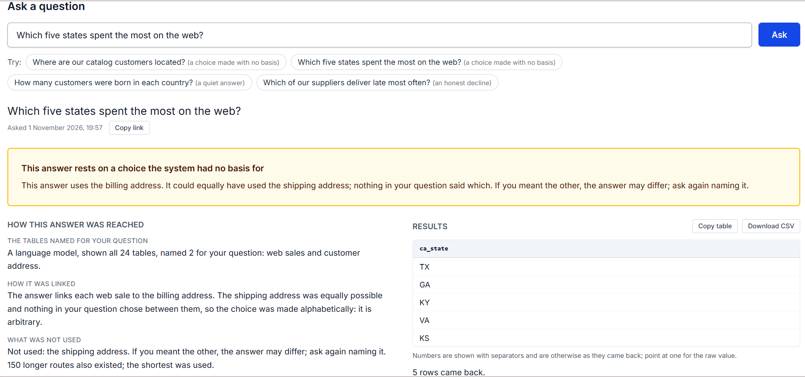
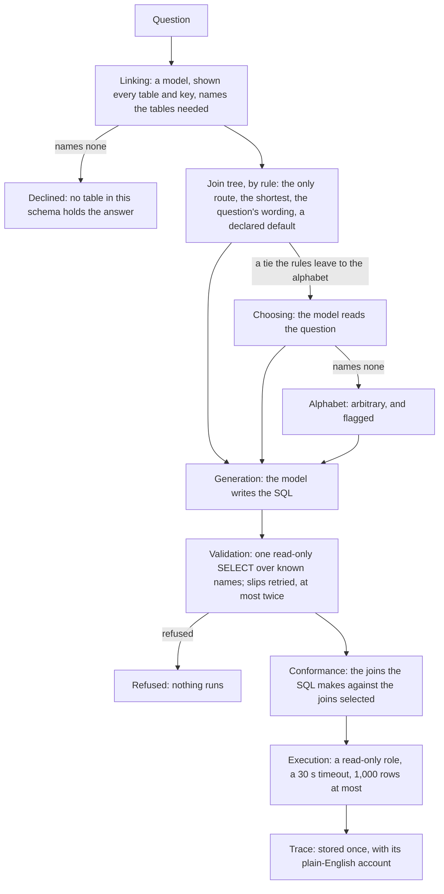
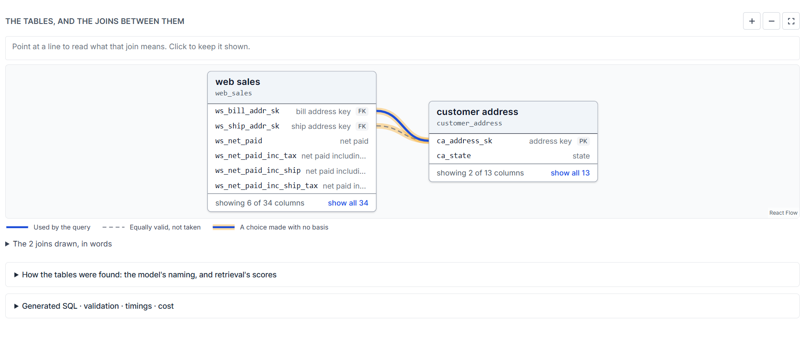

# Cartograph

Ask a question about a data warehouse in plain English: Cartograph writes the SQL, runs it read-only, and says how each join in that SQL was chosen.

**Live:** [cartograph-nl2sql.vercel.app](https://cartograph-nl2sql.vercel.app). The server sleeps after 15 minutes without visitors, so the first question after a quiet spell can take up to a minute; the page says so while it wakes.

## The problem

In a real warehouse, two tables can often be joined more than one way. A catalog sale holds a billing address and a shipping address; a web sale holds the demographics of the customer billed and of the customer it was shipped to. Ask "How much did each gender spend on the web in the year 2002?" of the scale factor 1 warehouse, summing the sales price (`ws_ext_sales_price`). By the billed customer's demographics, women spent 183,224,441.98 and men 178,618,746.26: women spent more. By the shipped-to customer's, women spent 178,673,143.87 and men 183,166,052.93: men spent more. Both queries run without error. Nothing in the result says which route was taken.

Cartograph says how each join was chosen: by a rule (the only route, the shortest, the question's own wording, or a default this warehouse declares), by a language model reading the question, or with no basis at all, in which case the choice was made alphabetically. That last kind is flagged on the page, with the routes that were not taken, so the reader knows the answer rests on a guess and can ask again more precisely.

Built with: Python, FastAPI, Pydantic, psycopg, SQLAlchemy and Alembic, sqlglot, networkx, argon2-cffi; PostgreSQL with pgvector, and Redis; TypeScript, Next.js, React, React Flow and Tailwind CSS; Docker Compose; OpenAI's API for the language model and the embeddings; hosted on Vercel, Render and Neon.

## How it works

*The graph drawn for "Which five states spent the most on the web?": the route used (solid, the billing address), the equally valid route set aside (dashed, the shipping address), and the choice made with no basis (the highlight on both).*

1. **Linking.** One model call is shown all 24 tables and all 107 keys between them, with the question, and names the tables the question needs. If it names none, Cartograph says so: "This cannot be answered from this schema: shown every table, the model named none that holds the answer." No query is written.
2. **The join tree.** The named tables are joined into one tree over the schema graph, built from the database's own foreign keys plus five relationships declared by hand, each with a note on its evidence. Where two tables can be joined more than one way, rules decide in order: the only route; the shortest; the route the question's wording points to; a default this warehouse declares. What is left is a tie, which the alphabet would break.
3. **Choosing.** Before the alphabet decides anything, a second model call is shown the question and each remaining tie, its routes listed in an order that does not favour the alphabet's pick, and asked which route the question means. If it names none, the alphabet chooses, and that choice is flagged as arbitrary.
4. **Generation.** The model that writes the query is shown the tables and the joins selected, as explicit join conditions.
5. **Validation.** The SQL is parsed and refused unless it is one SELECT over tables and columns the schema holds, calling only allowed functions. A syntax error or an unknown name is fed back and the model tries again, at most twice per question. A write, or a function known for a side effect, ends the question at once: the model is not asked again, and nothing runs.
6. **Conformance.** The joins the SQL really makes are read out of it, in `ON` clauses or as equalities in `WHERE`, and compared with the joins selected. If they differ the query still runs and the trace says **diverged**, naming the joins. A model that takes another route is reported, not corrected.
7. **Execution.** The SQL that runs is byte for byte the SQL that was checked. It runs as a role that can only read the warehouse, under the database's 30-second statement timeout, and at most 1,000 rows are fetched.
8. **The trace.** Every step's facts, every attempt and what each call cost are assembled into one document, with a plain-English account, and stored once. History reopens it exactly as it was first shown. The rows are not stored; "Run this SQL again" reruns the stored SQL, validated again, with no model call.

## Evaluation

Cartograph was measured against a fair baseline: the same model (gpt-6-luna, temperature 0), given all 24 tables of the warehouse and all 107 keys between them, with no plan. The two prompts differ only in what Cartograph adds, and tests pin that. A frozen judge scores each answer's SQL on two counts: whether it read the tables the question needs, and whether it joined them along the expected path. Where a path cannot be checked, such as a join on a computed key, the answer leaves the path count. The protocol, the code's hashes and the predictions were committed before any run, and each mode ran five times.

The headline set, heldout2, is 12 questions frozen before linking and choosing were built. Neither the design nor the code was made with sight of them: only the evaluation code opens the file.

| heldout2, mean of 5 runs | Right tables | Right path |
|---|---|---|
| **Cartograph v2.1: linking and choosing (adopted)** | **100.0%** | **98.3%** |
| Cartograph v2: linking | 91.7% | 80.0% |
| Full schema (the baseline) | 100.0% | 100.0% |
| Cartograph v1: retrieval | 36.7% | 30.0% |

- v1's weakness was finding the tables: on heldout2, the tables retrieval chose held 67.6% of those the questions need. Linking, a model shown every table and asked to name the ones needed, named all of them.
- v2.1 matches the baseline on tables, and misses it on path by one answer in sixty.
- What Cartograph adds is not accuracy but an account: every join choice says how it was made (by a rule, by the model reading the question, or with no basis), and a choice with no basis is flagged.
- On the original set, used throughout development (15 questions scored), v2.1 found the right tables more often than the baseline (84.0% against 77.3%) and the right path less often (77.1% against 82.9%).
- The first held-out set (12 questions) was spent at step 10, and its failures there shaped v2, so it has been a development set since. On it, v2.1 and the baseline both found the right tables and the right path 91.7% of the time.
- dev2 (12 questions) was seen during development, and its pilot results helped shape v2.1. On it, v2.1 scored 100.0% on tables and 91.7% on path; the baseline, 100.0% and 100.0%.
- An answer from v2.1 averages 2.17 model calls and 9,194 input tokens on heldout2, with a median of 5.4 seconds and $0.000973 uncached. The whole of step 10b's evaluation cost $0.280944.

Limits: the sets are small (12 and 15 questions), so one question is a large step; one model; the judge checks tables and path, not the rows returned; one warehouse, TPC-DS.

The protocol is backend/eval/step10b_protocol.md, the runs and the report are in backend/eval/step10b/runs/, and the working record is CHECKPOINTS.md.

### The first evaluation: v1, 18 October 2026

*Kept as written then. Here "Cartograph" means v1, retrieval, and "held-out" is the first held-out set.*

Measured on 18 October 2026, by a protocol committed before any run (`backend/eval/step10_protocol.md`). Two modes, with the same model (gpt-6-luna, temperature 0) and the same rules: Cartograph's pipeline, and full-schema prompting, which gives the model all 24 tables and all 107 keys between them, with no plan. Each question was asked five times in each mode. What is measured is whether the generated SQL read the expected tables and joined along the expected path, not whether its numbers were right.

| | Tables | Path |
|---|---|---|
| Held-out, 12 questions never run before: Cartograph | 20% (17–25) | 20% (17–25) |
| Held-out: full schema | 90% (83–100) | 90% (83–100) |
| Development, the 15 questions the system was tuned against: Cartograph | 65% (60–67) | 67% (64–71) |
| Development: full schema | 79% (73–80) | 84% (79–86) |

Means of five runs, with their range in brackets. A sixteenth development question was deleted from scoring before the runs; the protocol gives the reason.

At 24 tables the whole schema fits easily in the model's context, and full-schema prompting wins, as the protocol predicted before the runs. The cause is retrieval. For 9 of the 11 answerable held-out questions it did not bring a table the question needed (the date table, for a year, in 5 of them), and the model, told to use only the tables it was given, declined rather than guess. Retrieval found 64% of the tables the held-out questions needed, against 92% on the questions it was tuned on. Where it brought every table, the two modes scored the same on 9 of 13 questions.

These figures do not measure Cartograph's other claim, which is a property rather than a result: it says when a join choice had no basis, and it checks that the SQL that ran joined the way its explanation says.

## Decisions and alternatives

The design documents are in [docs/](docs/); each decision there records the option it was chosen against. The ones that shape what you see:

**Join rules, and flagging the arbitrary choice.** Between two tables the shortest route wins; a tie goes to the question's wording, then to a default the warehouse declares, then to the alphabet. Set aside: heuristics about cardinality or what a column means, which would be an assumption about a business that Cartograph, reading only a schema, has no knowledge of; and refusing to answer a tie, when ties are common in this schema (DD-21). The no-basis warning fires only when the alphabet decided, not whenever another route existed: this schema has 107 keys, and a warning on every question is no warning. In version 2.1, a model reading the question is asked before the alphabet, and the trace says which of the two decided.

**Linking replaced retrieval.** Version 1 found tables by embedding the schema and scoring the question against it, then growing a connected set along the graph. On the fresh held-out set the tables it chose held 67.6% of those the questions needed, and it scored 36.7% on tables. At 24 tables the whole schema fits in one prompt, so a model shown every table now names the ones needed, and on the same set it named all of them. Retrieval's scores are kept to order the named tables and as evidence for the wording rule. On a warehouse too large for one prompt, linking as built would not fit, and retrieval would be needed again.

**A fair baseline.** The comparison is full-schema prompting: the same model, given all 24 tables and every key, with no plan. The two prompts differ only in what Cartograph adds, and a test pins that. Set aside: comparing intermediate steps, such as the tables retrieved, which the baseline does not have. A frozen judge reads the generated SQL in both modes instead, and the protocol and predictions were committed before any run.

**The trace is one document, written once.** Each stage returns its part and the orchestrator writes the whole trace once, so a failure still leaves a trace and nothing is half-written. It is stored as a document with a few columns extracted for listing and counting. Set aside: five normalised tables, for something written once, read whole and never joined; and bare JSON with nothing extracted, when questions are asked across traces (how often ambiguity appeared, how often conformance failed, what each query cost), and asking them of a JSON body is awkward and error-prone. Its plain-English account is composed when the trace is written, not each time it is read, so history shows what was shown.

**Defence in depth on SQL.** No single guard is trusted. The validator refuses anything but one read-only SELECT over known names; the conformance check compares the joins made with the joins selected, and reports a difference rather than rejecting it, since rejecting would hide what the model did; the warehouse role can only read, and cannot make temporary tables either; the database itself stops a statement at 30 seconds. A refused write is never retried: retrying would coach the model past a safety check.

**One origin, a first-party cookie.** The browser only ever talks to the frontend's address; Next.js rewrites `/api/v1` to the backend. The session cookie is therefore first-party: HttpOnly, SameSite=Lax, Secure on the deployed site. Set aside: calling the backend's own address from the browser, which would need a cross-site cookie and credentialed CORS, a common source of failures that are hard to diagnose; and proxying through server functions, which run under a host's function time limit. A rewrite is a proxied request with no function in it.

**A spend ceiling that survives a restart.** The public demo has a monthly model budget, $2.00, counted from the costs stored with each answer in the database since the first of the month. Before a question runs, the most it could cost, worked out from the code (at most $0.023246) and rounded up to $0.03, is reserved, along with the same for any question already running; if that would pass the budget, the question is refused. Set aside: the development ceiling, a ledger file inside the container, which a free host's disk does not keep and which counted every call since the project began.

**An answer cache and rate limits, in Redis.** A question asked again within 24 hours is served from Redis when nothing that could change its answer has changed: the schema's hash, the join preferences, the mode, the models and their settings, the calibration, and the code that holds the prompts and the rules. The key is a hash of all of those and the question, trimmed and with its whitespace collapsed, so any change is a miss rather than a stale answer. Only answers and declines are cached, never a failure, and an entry holds nothing of who asked first. A cached answer calls no model, costs nothing, does not count towards the day's 30, and is served even when the month's budget is spent; it is stored in the asker's history as a new trace that says it came from the cache. The rate limits are counted in the same Redis, in fixed windows: five failed logins per email in 15 minutes, 300 logins an hour from everyone, 30 registrations an hour, and, for each account, 10 questions a minute and 30 reruns an hour. If Redis cannot be reached, both fail open: the question is asked as before, nothing is limited, and the log says so. Set aside: the application database, which the design keeps for what is durable and relational, and which holds no warehouse rows beyond what an answer displays (DR-15); and limits per client address, since behind Vercel and Render the address the API sees is not yet one it can trust.

**The hosting.** The design runs one Postgres server with two databases, the warehouse read through a role that can only read it. The deployment keeps the one server and the two databases, with three roles: Neon's owner, used only from the development machine to set up and load; the application's own, which owns the app database; and the read-only reader of the warehouse. Postgres is on Neon, whose free database does not expire and has pgvector; a public demo must stay up, and the free alternative considered expires after 30 days. The API is on Render, from the same Dockerfile used locally, on a free tier that does not expire; the price is the sleep after 15 minutes. A faster-waking host needed a card on file, and the model API is meant to be the only paid part. Render's Key Value sits beside the API, in memory only, which fits a cache: it holds the answer cache and the rate limits' counters. The frontend is on Vercel: the page runs in the browser and its API calls go through the rewrite, a CDN proxy allowed 120 seconds, so no function and no function time limit is involved.

## Security

A question can do one thing: run one validated SELECT against the warehouse, as a role that holds SELECT and nothing else, under a 30-second timeout, fetching at most 1,000 rows. It cannot write, lock, call a function known for a side effect, or reach the application's own database, which is a separate connection the query path never holds. The role cannot create a temporary table either, even with read-only switched off.

Passwords are hashed with argon2id. A session is a random token in a cookie (HttpOnly, SameSite=Lax, seven days from login, never extended; Secure on the deployed site, not on the local http stack); the server keeps only its sha256, and logging out revokes it. Any request that changes something is refused, 403, if it comes from another site's origin, and refused, 415, if its body is not JSON. Every page carries six security headers, among them a policy that it is never framed. Each account sees only its own history. Logins, registrations, questions and reruns are rate-limited; a key in Redis holds an email's sha256, never the email, and a login refused for too many failures says the same whether or not the account exists. The deployed API's image runs as a user that is not root, and carries no test packages.

The re-ingest endpoint exists only when `ADMIN_TOKEN` is set, at least 32 characters, and is sent as a bearer token, compared in constant time; to any other request it is 404, as a path that was never routed.

No credential is in the repository or its history. Locally, `bootstrap.sh` generates the passwords; deployed, each secret is set in the host's settings and never written to a file in the repository. The production model key was never written to a file or a command on the development machine; it was entered only in the host's settings.

## Deployment notes

- The page: [cartograph-nl2sql.vercel.app](https://cartograph-nl2sql.vercel.app), on Vercel, with `BACKEND_ORIGIN` set at build time for the rewrite.
- The API: a Render free web service and a free Key Value, both from [render.yaml](render.yaml), in Singapore. `FRONTEND_ORIGINS` names the page's address. The Key Value runs Valkey 8.1.10, which is Redis-compatible; the local stack runs Redis.
- Render deploys the API once CI passes, when a push changes `backend/`. Pushes whose last commit did not touch `backend/` were not deployed by themselves, and were deployed by hand.
- The data: Neon free, in Singapore, two databases: `warehouse` and `app`. [scripts/neon.sh](scripts/neon.sh) makes the roles and databases, loads the warehouse and checks it.
- The deployed warehouse is TPC-DS at scale factor 0.25, measured at 447 MB on Neon; locally it is scale factor 1, 2.2 GB. The schema, and so the snapshot's hash, is the same at both; the numbers in an answer are not.
- The first request after 15 minutes without visitors wakes the server, which can take up to a minute. After 3 seconds the page says: "Waking the server. Free hosting sleeps after 15 minutes without visitors; the first request can take up to a minute."
- The month's model budget is $2.00; when it is spent, a question is refused with 503 and a plain message, unless it was answered in the last 24 hours and can be served from the cache; stored answers can still be opened and run again. Each account may ask 30 questions a UTC day; past that, 429. A rerun calls no model and is not counted, and neither is an answer served from the cache.
- Rate limits answer 429 with `Retry-After` and say which limit was reached and when it lifts: 5 failed logins per email in 15 minutes, 300 logins an hour from everyone, 30 registrations an hour, and 10 questions a minute and 30 reruns an hour for each account.
- The Key Value drops the least recently used key when it is full (`maxmemoryPolicy: allkeys-lru` in render.yaml). Cached answers expire after 24 hours, and an answer over 256 KB is not cached.
- Render builds the Dockerfile's last stage, `runtime`: no pytest, run as a user that is not root. `./scripts/check_runtime.sh` builds that stage on its own and checks both, `pip check`, and that every module under `app/` imports. Compose builds the `dev` stage, which keeps the tests.
- Re-ingest, `POST /api/v1/admin/reingest`, is not enabled on the deployment. To enable it, set `ADMIN_TOKEN` in Render's settings for the API, at least 32 random characters, and send it as `Authorization: Bearer <token>`. It runs at most once in 10 minutes and needs Redis. It reads the live schema with the overlay and compares its hash with the calibration's: the same is 200 `unchanged` (and the pipeline is reopened if it was not open); a different one is 409, and nothing is stored.
- `./scripts/neon.sh accounts` counts the accounts the smoke commands made, with their sessions, queries and traces; `--yes` deletes them. It matches only their exact address patterns, never the local user.
- Neon made the databases with the collation C.UTF-8; locally they are en_US.utf8. Rows ordered by text can come back in a different order than locally.

## Running it locally

Developed and tested on Docker Desktop with the WSL2 backend. In order:

    ./scripts/bootstrap.sh
    docker compose up
    ./scripts/warehouse.sh
    docker compose exec backend python -m app.ingest_schema

1. `bootstrap.sh` writes a `.env` with generated passwords if there is none, and never overwrites one. Put your OpenAI key in `.env` as `OPENAI_API_KEY`.
2. `docker compose up` starts Postgres, Redis, the backend and the frontend: http://localhost:3000, and the API at http://127.0.0.1:8000/api/v1/health.
3. `warehouse.sh` builds TPC-DS at scale factor 1, about five minutes (`./scripts/warehouse.sh 0.01` takes thirty seconds). It needs the `duckdb` CLI and `python3` on the host. It downloads the TPC toolkit's constraint file from a commit-pinned mirror and checks its sha256 before changing anything.
4. `ingest_schema` reads the schema into the application database and embeds it once. It needs the key, and the embedding is the one paid call of setup.

Then:

- Ask from the command line: `docker compose exec backend python -m app.ask "Which five states spent the most on the web?"`. It prints the answer and the trace; two or three paid model calls.
- See the schema graph, or every route between two tables: `docker compose exec backend python -m app.show_schema`, and `docker compose exec backend python -m app.show_paths catalog_sales customer_address`.
- The smoke check, the one command every checkpoint is measured against: `./scripts/smoke.sh`. It asks two questions through the model, about a tenth of a cent, and asks the second again to see it served from the cache, at no cost.
- The tests: `docker compose exec backend pytest` for the backend against the running stack; `docker compose exec frontend npm test` for the frontend. CI's backend run, as reproduced locally, with no network and no `.env`: `docker run --rm --network none -v "$PWD/backend:/app" -w /app cartograph-backend pytest`. Tests that need the key or a database skip without them.

The key is needed by `ingest_schema`, by `ask` and asking on the page, by `show_retrieval` and `show_eval` for any question not embedded before, by smoke's question lines, and by the evaluation commands (`calibrate`, `probe_model`, `run_step10`, `run_step10b`). Without it, the stack, `show_schema`, `show_paths`, history and the tests run.

## Known limits

- No email verification and no password reset.
- Rate limits are per account and per email, not per client address: behind Vercel and Render the address the API sees is not yet one it can trust. The two global ceilings, 300 logins and 30 registrations an hour, can be used by anyone to stop everyone logging in, or registering, for up to an hour.
- History lists the newest 100 answers, with no paging.
- A copied answer link opens only for the answer's owner; anyone else gets "not found".
- Cartograph explains joins, not measures. Which amount column the model sums is not flagged: for "How much did each gender spend on the web in the year 2002?", summing the sales price and summing the net paid give totals millions apart, and nothing says which was used.
- Over the budget the demo serves only answers it can take from the cache: a question answered in the last 24 hours, on the same schema and code. Any other question is refused.
- A changed schema is detected and refused, not served: re-ingest compares the live schema's hash with the one retrieval was calibrated on, and recalibrating is an offline step. Re-ingesting on demand, as specified, is met only in part.
- Embedding spend has no ceiling of its own. The API makes one embedding call for each question it computes, for the question and its words and word pairs, and only for the texts its vector cache does not already hold; nothing at start, and nothing for an answer from the cache, a rerun, or a question refused by the budget, the day's 30 or a rate limit. Each call is on the spend ledger but outside the month's budget. One measured on 3 November: 15 tokens, $0.0000003. What bounds them: a call is made only for a question the budget has admitted, at most one per question, and a question of at most 500 characters makes at most about 2,000 tokens, about $0.00004. The schema is embedded only by the setup commands.
- An answer served from the cache shows, under the technical details, the model calls of the answer it copies, with their costs; the answer itself cost nothing.
- The evaluation's own limits are stated in it: small sets, one model, a judge that checks tables and path and not the rows, one warehouse.

## The repository

- [backend/app/core/](backend/app/core/): the pure parts, no I/O: the graph, the join rules, linking and choosing, validation, conformance, the trace and its narrative, the budget.
- [backend/app/shell/](backend/app/shell/): what touches a database or the model; [backend/app/](backend/app/) also holds the API and the commands.
- [backend/eval/](backend/eval/): the question sets, protocols, runs and reports of both evaluations.
- [backend/overlays/](backend/overlays/): what this warehouse's catalog cannot say: readable names, the hand-declared relationships, the declared defaults.
- [frontend/](frontend/): the Next.js page. [scripts/](scripts/): setup, the warehouse, Neon and smoke. [docs/](docs/): the charter, requirements, design and stack.
- [CHECKPOINTS.md](CHECKPOINTS.md): the working record, step by step: every ruling, measurement, prediction and mistake, and what was carried forward.

## TPC-DS

The warehouse's data is generated with TPC-DS tooling (DuckDB's `tpcds` extension, and the TPC toolkit's constraint file, which is not in this repository). Nothing here is a TPC-DS benchmark result, and nothing here is endorsed by the TPC.

## Contact

Built by Jagath S Manjunath: [GitHub](https://github.com/Jagath30) · [LinkedIn](https://www.linkedin.com/in/jagath-manjunath)
